# Tarea-Semana-4-Practica-3-
# Infraestructura 1: FortiGate con DMZ y segmentación por VLAN

**Video demostrativo:** [Ver en YouTube](ENLACE_DEL_VIDEO)

Autor: Jorge Emmanuel Sime Matos | Matrícula: 2025-0763
Instituto Tecnológico de las Américas (ITLA), Seguridad Informática | Asignatura: Seguridad de Redes

## Propósito del laboratorio

Este laboratorio implementa una red segmentada protegida por un FortiGate configurado por interfaz gráfica. La red de usuarios (VLAN 10 y VLAN 20) queda separada de una DMZ que aloja tres servidores: Sistema de Caja, Sistema de Inventario y un servidor de base de datos.

Las políticas de firewall cumplen los siguientes objetivos:

- Evitar que el tráfico de la DMZ llegue a la red LAN de usuarios.
- Impedir que la DMZ tenga acceso abierto a Internet, permitiendo únicamente el repositorio de actualizaciones del sistema operativo de los servidores.
- Permitir el acceso SSH a los servidores solamente desde la VLAN 20.
- Restringir a la VLAN 10 el acceso al Sistema de Inventario, mostrando una página de violación de política y registrando el evento.

## Topología

La topología se construyó en GNS3 con un FortiGate 7.0.9, dos switches, dos clientes webterm (uno por VLAN) y tres servidores Alpine Linux. El FortiGate sale a Internet a través de un nodo NAT.

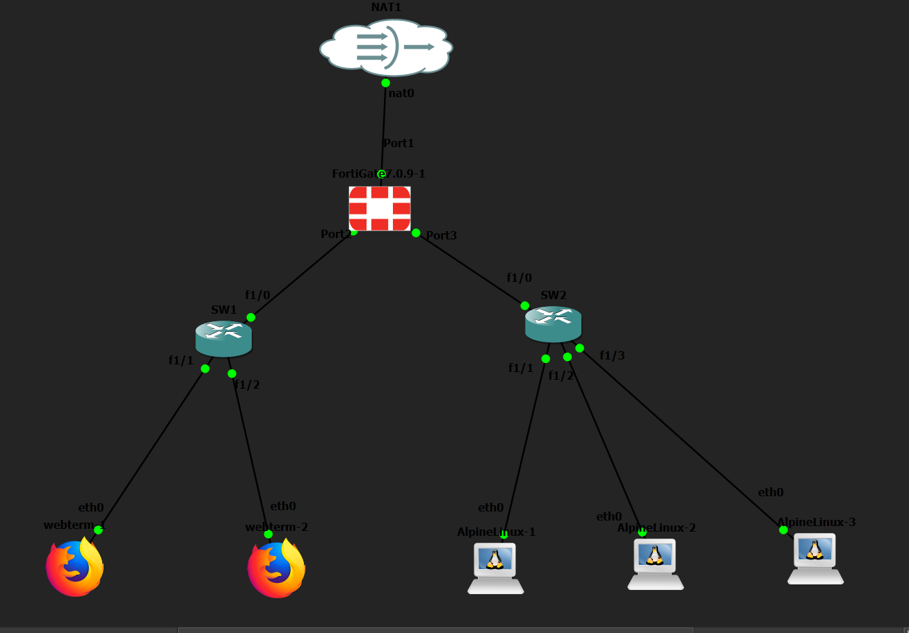

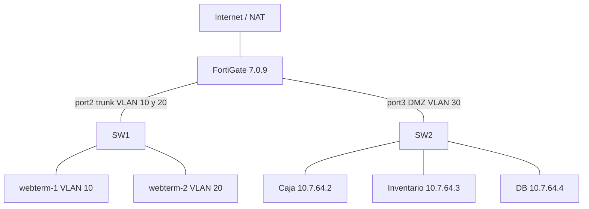

## Direccionamiento IP

El direccionamiento se calculó a partir de los dígitos 07 y 63 de la matrícula (2025-0763).

| Segmento | Red | Gateway | Observación |
|---|---|---|---|
| VLAN 10 Usuarios | 10.7.63.0/25 | 10.7.63.1 | DHCP, subinterfaz de port2 |
| VLAN 20 Usuarios | 10.7.63.128/25 | 10.7.63.129 | DHCP, subinterfaz de port2 |
| DMZ (VLAN 30) | 10.7.64.0/28 | 10.7.64.1 | Servidores, port3 |
| WAN | 192.168.42.0/24 | 192.168.42.1 | port1 por DHCP del NAT |

| Servidor | IP | Servicio |
|---|---|---|
| Sistema de Caja | 10.7.64.2 | Web (HTTP) |
| Sistema de Inventario | 10.7.64.3 | Web (HTTP) |
| DB Server | 10.7.64.4 | MariaDB (3306) |

## Switches

SW1 conecta los usuarios y SW2 la DMZ. Son routers c2691 con el módulo de switch NM-16ESW emulado en GNS3. En ambos, los puertos sin uso están en la VLAN 999 (BLACKHOLE) y apagados. Las VLAN no aparecen en el running-config porque este módulo las guarda en su base de datos de VLAN; su estado se muestra en las capturas.

El puerto fa1/0 de SW1 es un trunk 802.1Q hacia el FortiGate. El módulo emulado no aplicó la restricción de VLAN permitidas ni la VLAN nativa en el trunk.

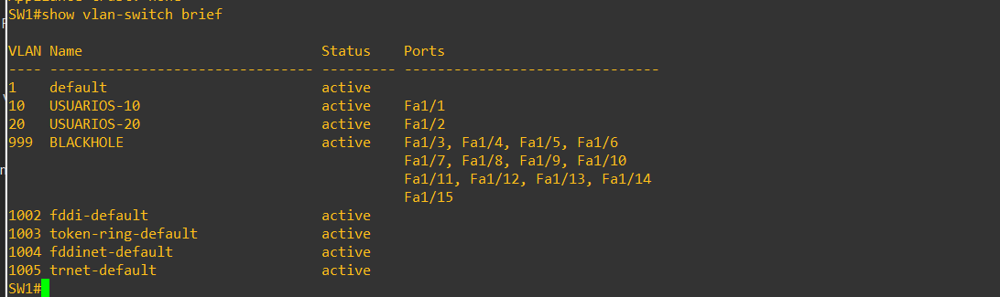
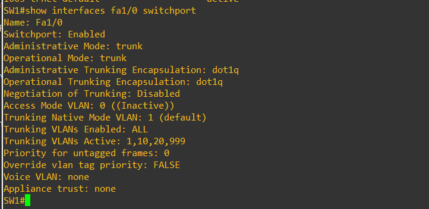
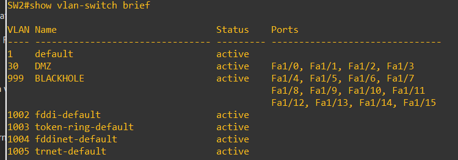

Configuraciones completas: [SW1](configs/SW1-running-config.txt) y [SW2](configs/SW2-running-config.txt).

## FortiGate

La configuración se realizó por GUI. La única excepción fue la creación inicial de la subinterfaz VLAN10 por consola, necesaria para abrir la GUI por primera vez desde la red de usuarios. El acceso a la GUI se hizo por HTTP desde la VLAN 10.

Respaldo de la configuración: [FortiGate-backup.conf](configs/FortiGate-backup.conf).

### Interfaces, rutas y DNS

port1 obtiene dirección por DHCP del NAT. port2 funciona como trunk con las subinterfaces VLAN10 y VLAN20, ambas con servidor DHCP. port3 es la interfaz DMZ. El FortiGate ofrece servicio DNS recursivo en VLAN10, VLAN20 y DMZ, y los servidores de la DMZ lo usan como DNS para resolver el repositorio de actualizaciones.

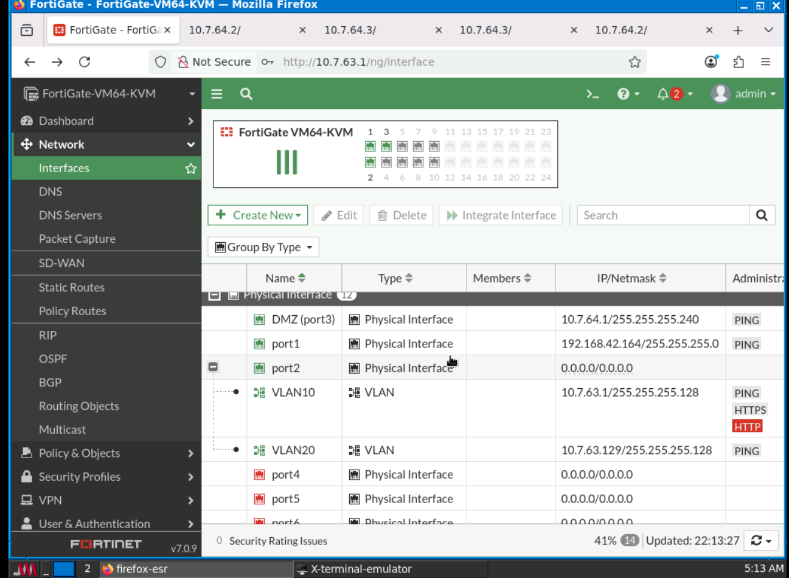
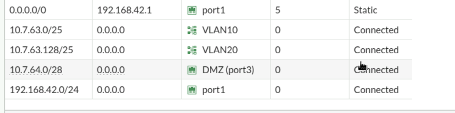
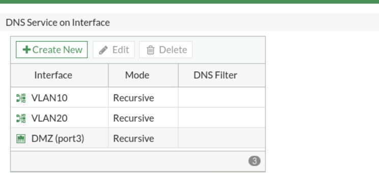
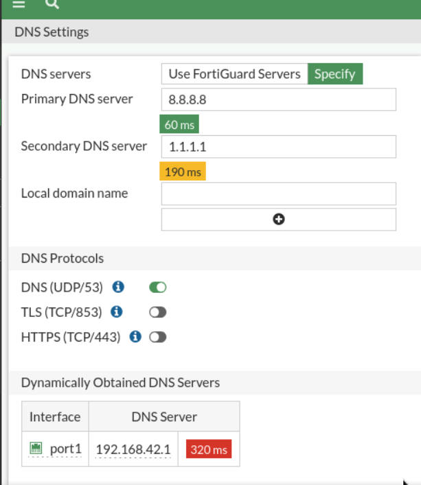

### Objetos de dirección

| Objeto | Tipo | Valor |
|---|---|---|
| VLAN10-NET | Subred | 10.7.63.0/255.255.255.128 |
| VLAN20-NET | Subred | 10.7.63.128/255.255.255.128 |
| DMZ-NET | Subred | 10.7.64.0/255.255.255.240 |
| SRV-CAJA | Subred | 10.7.64.2/32 |
| SRV-INVENTARIO | Subred | 10.7.64.3/32 |
| SRV-DB | Subred | 10.7.64.4/32 |
| FQDN-ALPINE | FQDN | dl-cdn.alpinelinux.org |
| UPDATE-ENDPOINTS | Grupo | Contiene FQDN-ALPINE |

### Perfil Web Filter

El perfil `BLOQUEO-INVENTARIO` usa un filtro de URL estático que bloquea la dirección 10.7.64.3. Se aplica únicamente en la política 3, de modo que el usuario de la VLAN 10 que intenta abrir el Sistema de Inventario recibe la página de violación de política y el evento queda registrado.

### Políticas de firewall

El FortiGate evalúa las políticas de arriba hacia abajo. Todo tráfico no listado cae en la denegación implícita, por lo que la DMZ no tiene acceso abierto a Internet.

| # | Nombre | Origen | Destino | Servicio | Acción |
|---|---|---|---|---|---|
| 1 | V20-SSH-DMZ | VLAN20 | DMZ-NET | SSH | Aceptar |
| 2 | V10-DENY-SSH | VLAN10 | DMZ-NET | SSH | Denegar con log |
| 3 | V10-INV-BLOCK | VLAN10 | SRV-INVENTARIO | HTTP | Aceptar con Web Filter (bloquea) |
| 4 | V10-DENY-INV | VLAN10 | SRV-INVENTARIO | ALL | Denegar con log |
| 5 | V10-WEB-CAJA | VLAN10 | SRV-CAJA | HTTP, HTTPS | Aceptar |
| 6 | V20-WEB-DMZ | VLAN20 | Caja, Inventario | HTTP, HTTPS | Aceptar |
| 7 | DMZ-DENY-LAN | DMZ | VLAN10, VLAN20 | ALL | Denegar con log |
| 8 | DMZ-UPDATES | DMZ-NET | UPDATE-ENDPOINTS | HTTP, HTTPS | Aceptar con NAT |
| 9 | LAN-INTERNET | VLAN10, VLAN20 | all | ALL | Aceptar con NAT |

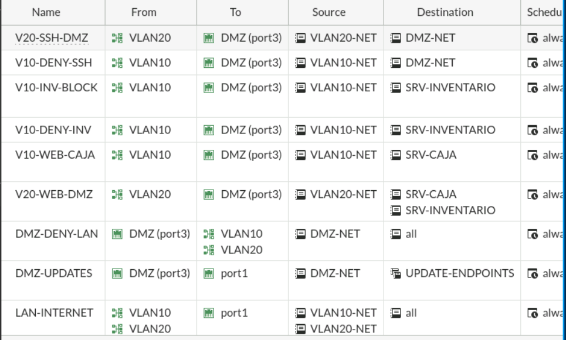

## Servidores

Los tres servidores son Alpine Linux con red estática, gateway 10.7.64.1 y el FortiGate como DNS. Los comandos de instalación están en [scripts/servidores-setup.sh](scripts/servidores-setup.sh).

## Pruebas realizadas

### La DMZ no tiene acceso abierto a Internet

Desde el servidor de la DMZ, el ping hacia la LAN (10.7.63.10) y hacia 8.8.8.8 falla con 100 % de pérdida, mientras que `apk update` funciona porque dl-cdn.alpinelinux.org está permitido por la política DMZ-UPDATES. Una descarga HTTP hacia otro sitio falla por tiempo de espera.

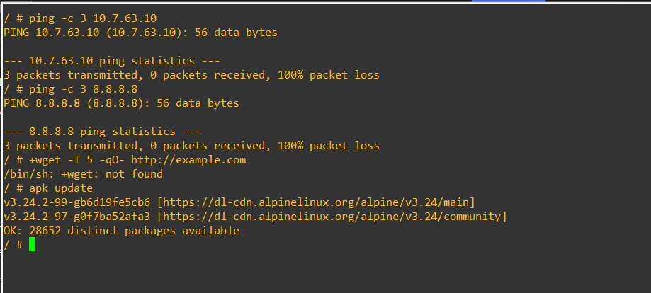
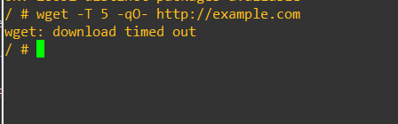

### Bloqueo de la VLAN 10 al Sistema de Inventario

El registro de tráfico del FortiGate muestra los intentos de la VLAN 10 hacia 10.7.64.3 atendidos por la política V10-INV-BLOCK (3) con el resultado "Deny: policy violation". Las dos primeras entradas permitidas son de pruebas anteriores a activar el perfil Web Filter.

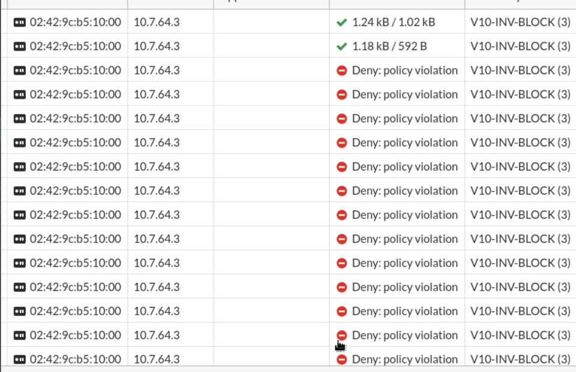

### Servidor de base de datos

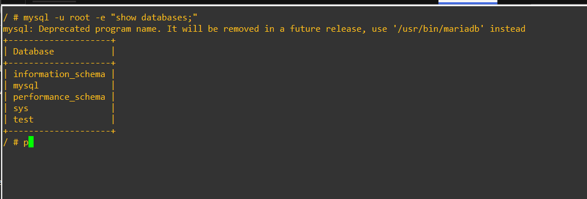

## Estructura del repositorio

```
README.md
docs/imagenes/
configs/FortiGate-backup.conf
configs/SW1-running-config.txt
configs/SW2-running-config.txt
scripts/servidores-setup.sh
```
